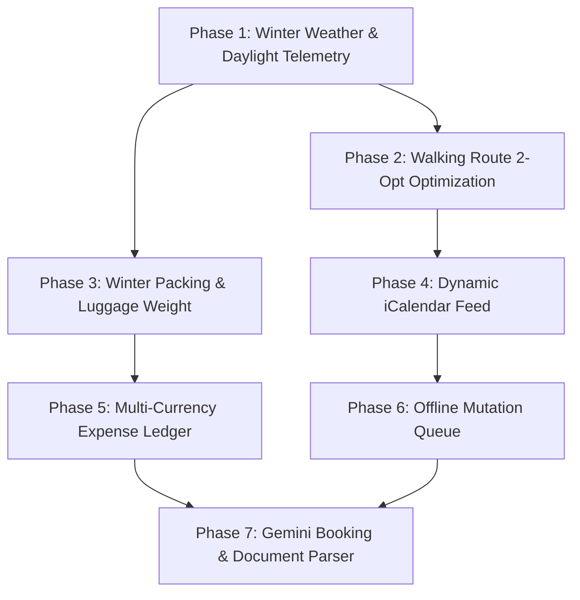

# Architectural Review and Feature Integration Plan: TREK to Wayfinder Guide

## 1. Executive Summary

An architectural review and feature gap analysis was conducted on the open-source travel planning platform TREK (https://github.com/liketrek/TREK.git). TREK is a self-hosted, collaborative travel planning suite built with NestJS, TypeScript, better-sqlite3, MikroORM, React 19, Zustand, Dexie, and Tailwind CSS.

Wayfinder Guide is TechTrekGT's dedicated winter expedition companion, tailored specifically for the Poland Christmas 2026 journey across Wrocław, Poznań, Toruń, Gdańsk, Warsaw, and Kraków. Wayfinder runs on a serverless edge architecture: pure ECMAScript JavaScript (React 19, Vite 6, Tailwind 3.4), custom client-side history routing, Cloudflare Workers (ESM), Cloudflare D1 SQLite (`personal-budget-db`), and shared SSO JWT authentication.

This review isolates high-value algorithms, data workflows, and UX paradigms from TREK that directly amplify Wayfinder Guide's utility for winter travelers, while discarding incompatible dependencies.

### Top Transferable Features Identified

1. Algorithmic Walking Route Optimization (Nearest Neighbor + 2-Opt Loop Untangling):
   Pure client-side geographic routing algorithm that reorders a day's points of interest to minimize total walking distance, anchored to the traveler's morning and evening hotel stays.
2. Key-Free Winter Weather & Daylight Telemetry (Open-Meteo Integration):
   Live 16-day forecasts, hourly temperatures, precipitation/snowfall probabilities, historical climate averages, and sunrise/sunset calculations without external API keys. This is critical for Poland in December where daylight lasts only from ~07:30 to 15:45 CET.
3. Dynamic iCalendar (.ics) Feed Generation (RFC 5545 VCALENDAR/VEVENT):
   Serverless calendar feed allowing travelers to subscribe to their live Poland 2026 itinerary, train transfers (PKP Intercity), flights (DL9208), and hotel check-in/out milestones directly in Apple Calendar, Google Calendar, or Outlook on iOS and Android.
4. Winter Packing Checklist & Baggage Weight Budgeting:
   Category-grouped packing manager with common vs. personal visibility tiers, luggage weight tracking (grams/kg against transatlantic 23 kg airline allowances), and winter clothing presets (thermal base layers, crampons, plug converters, waterproof boots).
5. Multi-Currency Expense Ledger & Debt Settle-Up Simplification:
   Travel cost ledger supporting equal or custom percentage splits across group members, frozen booking-time exchange rates (PLN, USD, EUR), and a debt simplification graph algorithm to calculate minimal settle-up transfers.
6. Offline Mutation Queue with Idempotency Replay:
   IndexedDB-backed queue using UUIDs as `X-Idempotency-Key` headers and negative temporary IDs to allow full offline checklist ticking, itinerary note editing, and expense logging while in flight or in underground transit stations, replaying atomically upon reconnect.
7. Intelligent Booking Document & Email Parsing (Gemini Structured Outputs):
   Production-grade replacement for TREK's heavy Linux KItinerary binary and Wayfinder's static simulated OCR heuristics. Ingests PDFs, images, and forwarded confirmation emails directly via a serverless Gemini 2.5 Flash pipeline with strict JSON schema enforcement, extracting multi-leg flights, train schedules, hotel check-ins, prices, currencies, and confirmation codes into the existing Wayfinder approval review workflow.

---

## 2. Incompatible Patterns to Discard

TREK's architecture contains several conventions and libraries that directly violate TechTrekGT ecosystem invariants. The following patterns are explicitly discarded:

| Target Pattern in TREK | Architectural Incompatibility | Wayfinder Compliant Solution |
| :--- | :--- | :--- |
| TypeScript (.ts / .tsx) | TechTrekGT mandates 100% pure JavaScript (ESM / JSX). No TypeScript compilation or type checking is permitted. | Translate all algorithms, contracts, and components into pure JavaScript (ESM/JSX) with structured JSDoc comments. |
| NestJS / Express / Docker | TechTrekGT executes entirely on serverless Cloudflare Workers and Cloudflare Pages. Long-running Node.js processes and Docker containers are prohibited. | Implement API handlers as lightweight ESM Worker modules inside `wayfinder/src/worker.js` and `wayfinder/functions/api/wayfinder/`. |
| better-sqlite3 & MikroORM | TechTrekGT uses Cloudflare D1 SQLite (`personal-budget-db`) via `env.DB.prepare()` with positional parameter bindings (`?1`, `?2`). | Write native SQLite SQL migrations in `wayfinder/schema-wayfinder.sql` and execute parameterized statements via `env.DB`. |
| react-router-dom | Third-party routing libraries are strictly forbidden. Wayfinder uses custom SPA history routing (`window.history.pushState` and `popstate`). | Route views via existing `App.jsx` path matching and normalized subpath handlers. |
| Zustand & Redux | Wayfinder enforces standard React Context (`WayfinderContext`, `AuthContext`, `SettingsContext`) and native hooks (`useState`, `useReducer`, `useMemo`). | Port state slices into cohesive React Context providers with zero external state libraries. |
| WebSockets Realtime Gateway | Cloudflare Workers serverless model makes long-lived WebSockets complex and expensive (requiring Durable Objects). Wayfinder operates on an asynchronous REST and optimistic local state model. | Utilize optimistic local UI updates combined with debounced D1 persistence and periodic re-fetching. |
| Sandboxed Plugins & MCP Server | TREK includes a heavy child-process plugin sandbox and 410-tool MCP server. This is out of scope for a focused winter travel companion. | Exclude plugin sandboxing and MCP decorators. Keep codebase lean, secure, and focused on traveler UX. |
| Punctuation (Em Dashes) | Global workspace rules strictly forbid em dashes. | Use standard hyphens (-) or colons (:) exclusively across all code and documentation. |

---

## 3. Detailed Architectural Gap Analysis & Transferred Capabilities

### 3.1 Algorithmic Walking Route Optimization (2-Opt & Nearest Neighbor)
- TREK Implementation: `client/src/components/Map/RouteCalculator.ts` (`optimizeRoute`, `nearestNeighborOrder`, `twoOptImprove`).
- Current Wayfinder State: Wayfinder displays POIs in fixed catalog order or chronological itinerary time order. When travelers add 4 to 8 sights in a city (e.g. Kraków: Wawel Castle, Cloth Hall, Rynek Underground, St. Mary's Basilica, Kazimierz), there is no automated routing to minimize freezing winter walks.
- Porting Strategy:
  - Extract the pure mathematical algorithms (`haversineKm`, `sqDist`, `nearestNeighborOrder`, `twoOptImprove`) into a dedicated client utility `wayfinder/src/utils/routeOptimizer.js`.
  - Accept `places` array with `{ lat, lng, id, title }` and optional `anchors` (`start` and `end` hotel coordinates).
  - First pass: Nearest-neighbor algorithm finds a low-cost initial traversal.
  - Second pass: 2-opt loop repeatedly reverses path sub-segments whenever the total Euclidean/Haversine distance decreases, eliminating crossing loops.
  - Round-trip orientation: If the hotel is both start and end, orient the loop to start at the sight closest to the hotel.
  - Zero external API dependencies: Runs in < 2 milliseconds directly in the browser with zero network latency.

### 3.2 Winter Weather & Daylight Telemetry Service (Open-Meteo)
- TREK Implementation: `server/src/nest/weather/weather.impl.ts` and `client/src/components/Weather/WeatherWidget.tsx`.
- Current Wayfinder State: Static winter temperature summaries in `poland-2026.js` (e.g., "-1°C to 4°C"). No live forecast, no daylight calculation, and no snowfall warnings.
- Porting Strategy:
  - Add Worker proxy endpoint: `GET /api/wayfinder/weather?lat={lat}&lng={lng}&date={YYYY-MM-DD}` in `wayfinder/src/worker.js`.
  - Upstream Provider: Query Open-Meteo API (`https://api.open-meteo.com/v1/forecast`), which is completely free, requires no API key, and provides:
    - 16-day daily forecast (`temperature_2m_max`, `temperature_2m_min`, `precipitation_probability_max`, `snowfall_sum`, `weather_code`).
    - Exact sunrise and sunset times (crucial for winter planning: Polish Christmas markets peak after dark, but Old Town photography requires daylight between 08:00 and 15:30).
    - Historical climate fallback (`https://archive-api.open-meteo.com/v1/archive`) when planning outside the 16-day live window.
  - Worker Edge Caching: Cache weather responses in Cloudflare Cache API or in-memory KV for 3 hours (10,800 seconds) to prevent redundant queries.
  - UI Component: `wayfinder/src/components/weather/WeatherBadge.jsx` displaying temperature, weather condition icon, snowfall indicator, and daylight window pill.

### 3.3 Dynamic iCalendar (.ics) Feed Generator
- TREK Implementation: `server/src/nest/calendar/calendar.service.ts` and `server/src/nest/feeds/feeds.service.ts`.
- Current Wayfinder State: Private bookings and itinerary events are stored in D1 (`wayfinder_itinerary_items`), but travelers cannot access them in their mobile native calendars.
- Porting Strategy:
  - Add public token-authenticated calendar feed endpoint: `GET /api/wayfinder/calendar/feed/:token.ics`.
  - Add direct download endpoint: `GET /api/wayfinder/calendar/export.ics` (authenticated via session cookie).
  - Implementation: Pure ESM RFC 5545 generator in `wayfinder/functions/api/wayfinder/calendar.js`.
  - Event Types Handled:
    - Inbound/Outbound Flights (e.g. DL9208 touchdown Dec 4, 2026 at 13:30 CET).
    - PKP Intercity Rail transfers with departure/arrival stations and train numbers.
    - Hotel check-in and check-out windows with addresses and booking confirmation numbers.
    - Scheduled Christmas market visits, dinners, and museum entries.
  - Output: Standard MIME `text/calendar; charset=utf-8` with 75-octet line folding and UTC timestamps (`DTSTART`, `DTEND`, `SUMMARY`, `DESCRIPTION`, `LOCATION`).
  - Mobile Integration: 1-click "Add to Calendar / Subscribe" modal in `PrivateHub.jsx` and `BottomTabBar.jsx`.

### 3.4 Winter Packing Checklist & Luggage Weight Calculator
- TREK Implementation: `client/src/components/Packing/` (`packingListModel.ts`, `usePackingListPanel.ts`, `PackingListPanel.tsx`).
- Current Wayfinder State: Practical guide in `PracticalPage.jsx` has static bulleted text advice on clothing, but no interactive checklist or weight budgeting.
- Porting Strategy:
  - Add D1 table: `wayfinder_packing_items` linked to user and journey.
  - Item fields: `id`, `user_id`, `journey_id`, `category`, `name`, `quantity`, `weight_grams`, `is_packed`, `is_shared`, `notes`.
  - Packing Categories: Clothing (Warm Layers), Footwear & Cold Gear, Electronics & Adapters, Travel Documents, Toiletries & Medical, Christmas Gifts & Souvenirs.
  - Pre-seeded Expedition Template: "Poland Winter 2026 Preset" pre-populating thermal base layers, wool socks, waterproof snow boots, hand warmers, Type C/E power converters, passport, and Polish zloty emergency cash.
  - Weight Allowance Progress: Real-time sum of `weight_grams * quantity`, converted to kg, comparing against airline 23.0 kg (50.7 lbs) checked baggage limit.
  - UI Component: `wayfinder/src/components/packing/PackingChecklist.jsx` embedded into `PrivateHub.jsx` with tabs for "Packed" vs "To Pack" and filter by category.

### 3.5 Multi-Currency Group Expense Ledger & Debt Settle-Up
- TREK Implementation: `client/src/components/Budget/` (`costsModel.ts`, `CostsPanel.tsx`, `useCostsLedger.ts`).
- Current Wayfinder State: `wayfinder_expenses` table tracks basic total costs, but lacks participant-level splitting, payer tracking, and debt settlement simplification.
- Porting Strategy:
  - Add D1 table: `wayfinder_expense_splits` to record individual member liability.
  - Ledger Math Utility: Pure JS `wayfinder/src/utils/expenseLedger.js` implementing:
    - Multi-currency normalization (PLN, USD, EUR) using frozen booking exchange rates.
    - Equal splitting with remainder cent distribution (ensuring total cents match exactly).
    - Custom percentage and fixed amount splits.
    - Settle-up debt simplification: Greedy graph algorithm resolving who owes whom with the minimum number of transactions (e.g., "Alice pays Bob 145 PLN" instead of 5 circular payments).
  - UI Component: `wayfinder/src/components/budget/ExpenseLedgerCard.jsx` embedded in `PrivateHub.jsx` displaying trip total spend, user share, active balances, and settle-up action cards.

### 3.6 Resilient Offline Mutation Queue
- TREK Implementation: `client/src/sync/mutationQueue.ts` and `client/src/db/offlineDb.ts`.
- Current Wayfinder State: IndexedDB stores PDF documents locally (`wayfinder/src/utils/documentStorage.js`), but API mutations (such as checking off packing items or updating itinerary notes) fail if connectivity is lost during underground travel or spotty cellular roaming.
- Porting Strategy:
  - Extend `wayfinder/src/utils/documentStorage.js` with an IndexedDB store: `mutation_queue`.
  - Queue item structure: `{ id, url, method, body, createdAt, status, idempotencyKey }`.
  - Interceptor: When `fetch()` fails due to network outage, pending writes are appended to `mutation_queue` with a unique UUID `X-Idempotency-Key` and an optimistic update is applied to React Context.
  - Background Flush: A window `online` listener and app-focus handler sequentially replays queued mutations to the Cloudflare Worker, which processes them idempotently.

### 3.7 Intelligent Booking Document & Email Parsing (Gemini Structured Outputs)
- TREK Implementation: `server/src/nest/booking-import/` (`booking-import.service.ts`, `kitinerary-extractor.service.ts`, `kitinerary-mapper.ts`, `import-jobs.service.ts`) and `server/src/nest/llm-parse/` (`llm-parse.service.ts`).
  - TREK relies on a 3-tier pipeline:
    1. Local execution of KDE C++ `kitinerary-extractor` binary on Linux host.
    2. Optional LLM fallback (`OpenAI` / `Anthropic` / `Ollama`) with custom JSON prompt formatting when KItinerary produces empty results or for photo uploads.
    3. Type mapping: normalizes raw schema.org entities into 9 typed booking domains (`flight`, `train`, `bus`, `boat`, `hotel`, `restaurant`, `car`, `event`, `TouristAttractionVisit`).
    4. Station geocoding: runs auxiliary Google Maps queries to resolve coordinates for named train stations and car rental counters.
    5. Cost freezing: extracts price and currency to create linked expense ledger records at the booking date exchange rate.
- Current Wayfinder State:
  - Document Center Uploads: `wayfinder/src/components/DocumentCenter.jsx` uses a client-side mock function `simulateExtraction(file)` that matches file name keywords (e.g., `delta` yields synthetic DL9208 flight data; `hotel` yields mock Kraków Grand Hotel data). It does not inspect document text or images.
  - Inbound Email Routing: `wayfinder/functions/api/wayfinder/email-worker.js` parses incoming forwarded emails using basic regex patterns with hardcoded December 2026 date bounds (`2026-(12)-(0[1-9]|1[0-5])`). Any reservation outside early December or formatted differently fails extraction.
- Porting Strategy & Architecture:
  - Dual-Ingestion Serverless Pipeline:
    1. Interactive Document Parsing: Add `POST /api/wayfinder/import-jobs/parse` in `wayfinder/src/worker.js`. Accepts file uploads (`.pdf`, `.png`, `.jpg`, `.html`) or text snippets from `DocumentCenter.jsx`.
    2. Cloudflare Inbound Email Parsing: Upgrade `email-worker.js` to a 2-stage parser:
       - Stage 1: Ultra-fast regex pass for standard booking confirmations.
       - Stage 2 (Low Confidence Fallback): If item type is uncertain, confirmation code is missing, or date parsing fails, pass the MIME plain-text body to Gemini 2.5 Flash via REST API with a strict JSON schema.
  - Gemini Structured Output Schema:
    Enforce JSON schema validation (`responseMimeType: "application/json"`, `responseSchema`) guaranteeing valid schema fields:
    - `item_type`: enum [`flight`, `rail`, `hotel`, `excursion`, `restaurant`, `transport`, `other`]
    - `title`: string (e.g., "PKP Intercity 13100: Wrocław Główny -> Poznań Główny")
    - `provider`: string (e.g., "PKP Intercity", "Delta Air Lines", "Puro Hotel")
    - `confirmation_number`: string (e.g., "XYZ987", "PLN-39201")
    - `start_date`: string (ISO YYYY-MM-DD)
    - `start_time`: string (24-hour HH:MM)
    - `end_date`: string (ISO YYYY-MM-DD)
    - `end_time`: string (24-hour HH:MM)
    - `location`: string (street address, city)
    - `origin`: string (departure station / airport IATA)
    - `destination`: string (arrival station / airport IATA)
    - `price`: number (total cost)
    - `currency`: string (ISO 4217: PLN, USD, EUR)
    - `seat`: string (seat / platform / coach number)
    - `confidence`: enum [`high`, `medium`, `low`]
  - Safe-Storage & Privacy Guardrail:
    Scrub credit card numbers, CVVs, and passport numbers prior to D1 persistence (already enforced in `import-jobs.js`).
  - Integration with Existing Approval Gate:
    Populate `wayfinder_extracted_fields` and update `wayfinder_extraction_jobs` status to `ready_for_review`. The user verifies details in `DocumentCenter.jsx`'s existing review modal before the booking lands in `wayfinder_itinerary_items`.

---

## 4. Phased Implementation Roadmap




### Phase 1: Winter Weather & Daylight Telemetry Service [COMPLETED]
- Status: Fully implemented and deployed to production.
- Deliverables:
  - Created `wayfinder/functions/api/wayfinder/weather.js` (Worker Open-Meteo proxy with 16-day forecast, archive climate modeling, daylight hours, and freezing advisories).
  - Registered route in `wayfinder/src/worker.js`.
  - Created `wayfinder/src/components/weather/WeatherWidget.jsx` with Celsius/Fahrenheit support, daylight pill, and downward-positioned card popup.
  - Integrated into `wayfinder/src/components/PolandLanding.jsx` stop headers & daily strips, and `wayfinder/src/components/ItineraryView.jsx` day cards.

### Phase 2: Client-Side Route & Walking Loop Optimization [COMPLETED]
- Status: Fully implemented and deployed to production.
- Deliverables:
  - Created `wayfinder/src/utils/routeOptimizer.js` (Pure ESM, Nearest-Neighbor + 2-opt untangling engine with Haversine distance, winter walking pace telemetry, and Google Maps multi-stop URL builder).
  - Created `wayfinder/src/components/route/WalkingLoopOptimizer.jsx` (Interactive control bar with guide order vs 2-opt toggle, distance/time savings badges, anchor selectors, and Google Maps walking route deep-link).
  - Updated `wayfinder/src/components/city/CityAttractionsTab.jsx` with dynamic route optimization state and excursion partitioning for sights >12km away.
  - Updated `wayfinder/src/components/MustSeeCard.jsx` to render step badges (`#1`, `#2`...) and walking leg distance/time callouts.
  - Deployed to Cloudflare Workers (Version ID: `74fc89e4-1961-4f46-bdb1-2e6239b4f3b3`). Documented in `wayfinder/docs/03_features.md` and `wayfinder/docs/04_state.md`.

### Phase 3: Winter Packing Checklist & Luggage Weight Budget
- Goal: Deliver an interactive packing checklist pre-loaded with winter Poland gear and luggage weight tracking.
- Files to Create/Modify:
  - Add `wayfinder_packing_items` schema to `wayfinder/schema-wayfinder.sql`.
  - Create `wayfinder/functions/api/wayfinder/packing.js`.
  - Register route in `wayfinder/src/worker.js`.
  - Create `wayfinder/src/components/packing/PackingManager.jsx`.
  - Mount inside `wayfinder/src/components/PrivateHub.jsx` and link from `PracticalPage.jsx`.

### Phase 4: Live iCalendar (.ics) Feed Generator
- Goal: Enable travelers to subscribe to their Poland 2026 itinerary, trains, and flights directly in their mobile calendars.
- Files to Create/Modify:
  - Add `wayfinder_calendar_tokens` schema to `wayfinder/schema-wayfinder.sql`.
  - Create `wayfinder/functions/api/wayfinder/calendar.js` (RFC 5545 generator).
  - Register feed and export routes in `wayfinder/src/worker.js`.
  - Create `wayfinder/src/components/calendar/CalendarSubscribeModal.jsx`.
  - Add subscription launcher in `PrivateHub.jsx` and `BottomTabBar.jsx`.

### Phase 5: Multi-Currency Group Expense Ledger & Debt Settle-Up
- Goal: Provide precise cost splitting, currency freezing at booking time, and automated debt settlement recommendations.
- Files to Create/Modify:
  - Add `wayfinder_expense_splits` schema to `wayfinder/schema-wayfinder.sql`.
  - Create `wayfinder/src/utils/expenseLedger.js` (split math & greedy settle-up graph).
  - Create `wayfinder/functions/api/wayfinder/expense-splits.js`.
  - Update `wayfinder/src/components/DocumentCenter.jsx` and `PrivateHub.jsx` to render the unified Expense Ledger.

### Phase 6: Resilient Offline Mutation Queue
- Goal: Guarantee zero data loss when editing notes, packing items, or expenses during underground train journeys or offline roaming.
- Files to Create/Modify:
  - Update `wayfinder/src/utils/documentStorage.js` with `mutation_queue` IndexedDB store.
  - Create `wayfinder/src/utils/mutationQueue.js`.
  - Integrate optimistic queue replay into `WayfinderContext.jsx`.

### Phase 7: Intelligent Booking Document & Email Parsing (Gemini Structured Outputs)
- Goal: Replace static client-side heuristic simulation and rigid regex date matching with an intelligent, serverless Gemini 2.5 Flash structured parser for PDFs, images, and forwarded booking emails.
- Files to Create/Modify:
  - Create `wayfinder/functions/api/wayfinder/gemini-parser.js` (Pure ESM Gemini REST API client with structured JSON schema and prompt builder).
  - Update `wayfinder/functions/api/wayfinder/email-worker.js` (Add Stage 2 fallback to Gemini when regex confidence is low).
  - Update `wayfinder/functions/api/wayfinder/import-jobs.js` and `wayfinder/src/worker.js` (Add `POST /api/wayfinder/import-jobs/parse` route).
  - Update `wayfinder/src/components/DocumentCenter.jsx` (Replace `simulateExtraction(file)` with real backend Gemini extraction call).

---

## 5. Proposed Data Schemas & API Contracts

### 5.1 Cloudflare D1 SQLite Schema Additions (`schema-wayfinder.sql`)

```sql
-- ============================================================
-- PACKING ITEMS - Personal & Group Winter Packing Checklist
-- ============================================================
CREATE TABLE IF NOT EXISTS wayfinder_packing_items (
  id              TEXT PRIMARY KEY,
  journey_id      TEXT NOT NULL,
  user_id         TEXT NOT NULL,
  category        TEXT NOT NULL DEFAULT 'clothing', -- clothing, footwear, gear, electronics, documents, medical, gifts
  name            TEXT NOT NULL,
  quantity        INTEGER NOT NULL DEFAULT 1,
  weight_grams    INTEGER DEFAULT 0,
  is_packed       INTEGER NOT NULL DEFAULT 0,
  is_shared       INTEGER NOT NULL DEFAULT 0,       -- 0: personal item, 1: group item
  assigned_to     TEXT,                             -- users(id) for shared gear
  notes           TEXT,
  sort_order      INTEGER NOT NULL DEFAULT 0,
  created_at      TEXT NOT NULL DEFAULT (datetime('now')),
  updated_at      TEXT NOT NULL DEFAULT (datetime('now')),
  FOREIGN KEY (journey_id)  REFERENCES wayfinder_journeys(id) ON DELETE CASCADE,
  FOREIGN KEY (user_id)     REFERENCES users(id) ON DELETE CASCADE
);

CREATE INDEX IF NOT EXISTS idx_wf_packing_journey ON wayfinder_packing_items(journey_id);
CREATE INDEX IF NOT EXISTS idx_wf_packing_user    ON wayfinder_packing_items(user_id);

-- ============================================================
-- EXPENSE SPLITS - Individual Member Allocations
-- ============================================================
CREATE TABLE IF NOT EXISTS wayfinder_expense_splits (
  id              TEXT PRIMARY KEY,
  expense_id      TEXT NOT NULL,
  user_id         TEXT NOT NULL,
  amount_owed     REAL NOT NULL,
  percentage      REAL,
  is_settled      INTEGER NOT NULL DEFAULT 0,
  settled_at      TEXT,
  created_at      TEXT NOT NULL DEFAULT (datetime('now')),
  FOREIGN KEY (expense_id) REFERENCES wayfinder_expenses(id) ON DELETE CASCADE,
  FOREIGN KEY (user_id)    REFERENCES users(id) ON DELETE CASCADE
);

CREATE INDEX IF NOT EXISTS idx_wf_splits_expense ON wayfinder_expense_splits(expense_id);
CREATE INDEX IF NOT EXISTS idx_wf_splits_user    ON wayfinder_expense_splits(user_id);

-- ============================================================
-- CALENDAR SUBSCRIPTION TOKENS - Secure Token-Based iCal Feeds
-- ============================================================
CREATE TABLE IF NOT EXISTS wayfinder_calendar_tokens (
  id              TEXT PRIMARY KEY,
  user_id         TEXT NOT NULL,
  journey_id      TEXT NOT NULL,
  token           TEXT NOT NULL UNIQUE,             -- 32-char crypto random token
  feed_name       TEXT NOT NULL DEFAULT 'Poland 2026 Schedule',
  is_active       INTEGER NOT NULL DEFAULT 1,
  last_polled_at  TEXT,
  poll_count      INTEGER NOT NULL DEFAULT 0,
  created_at      TEXT NOT NULL DEFAULT (datetime('now')),
  FOREIGN KEY (user_id)    REFERENCES users(id) ON DELETE CASCADE,
  FOREIGN KEY (journey_id) REFERENCES wayfinder_journeys(id) ON DELETE CASCADE,
  UNIQUE(user_id, journey_id)
);

CREATE INDEX IF NOT EXISTS idx_wf_cal_token ON wayfinder_calendar_tokens(token);
```

### 5.2 Serverless Cloudflare Worker API Routes

| Endpoint | Method | Auth | Description |
| :--- | :--- | :--- | :--- |
| `/api/wayfinder/weather` | GET | Public | Proxies Open-Meteo 16-day forecast & historical climate for coordinates. In-memory edge caching for 3 hours. |
| `/api/wayfinder/calendar/export.ics` | GET | SSO Cookie | Downloads a snapshot RFC 5545 `.ics` file of all itinerary events, flights, and booked accommodations. |
| `/api/wayfinder/calendar/feed/:token.ics` | GET | Token URL | Public subscription endpoint for calendar clients (Apple Calendar, Google Calendar) authenticated via unique token. |
| `/api/wayfinder/packing` | GET, POST | SSO Cookie | Retrieves checklist items or creates a new item / applies template preset. |
| `/api/wayfinder/packing/:id` | PUT, DELETE | SSO Cookie | Updates packing item status (`is_packed`, `quantity`, `weight_grams`) or removes item. |
| `/api/wayfinder/expenses/splits` | GET, POST | SSO Cookie | Calculates debt balances, manages splits, and records settle-up payments. |
| `/api/wayfinder/import-jobs/parse` | POST | SSO Cookie | Parses uploaded documents (PDF, image, text) with Gemini 2.5 Flash and returns structured booking fields. |

---

## 6. Pre-Flight Safety Verification & Zero-Drift Checklist

- Architecture Source of Truth: Verified distributed documentation in `docs/01_identity.md`, `docs/02_arch.md`, `docs/03_features.md`, and `docs/04_state.md`. Zero legacy ARCHITECTURE.md files referenced.
- Punctuation Guardrail: Zero em dashes used throughout the plan. Hyphens and colons used exclusively.
- Stack Invariants: Pure JavaScript (ESM/JSX) only. No TypeScript, no react-router-dom, no Zustand.
- Database Invariants: D1 SQLite (`personal-budget-db`) with parameterized SQL bindings (`?1`, `?2`).
- Scope Protection: Core Poland 2026 travel focus preserved (Christmas markets, dual-verified POIs, private document vault).
