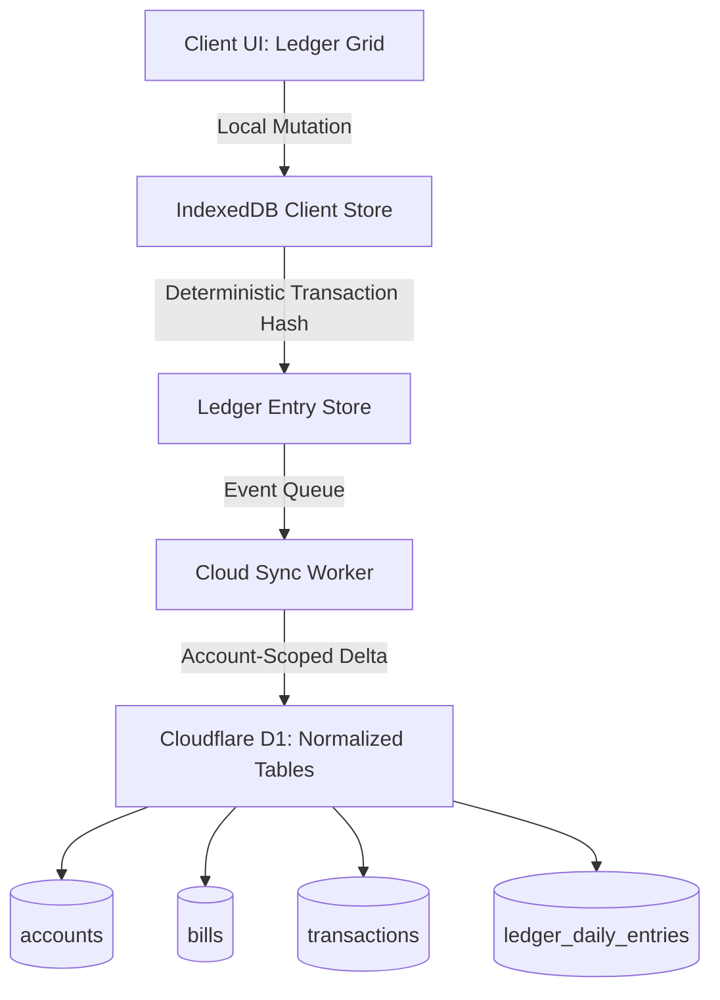

# Implementation Plan & Architectural Audit: Ledger Deduplication, Import Reconciliation & Storage Engine

**File:** `docs/plan_ledger_import_audit.md`  
**Application:** TechTrekGT - Finance OS (`finance/`)  
**Status:** DRAFT (Awaiting User Review)  

---

## Executive Summary

This document presents a comprehensive diagnostic investigation and architectural audit for Finance OS, addressing the reported ledger discrepancies and establishing a robust architectural baseline:

1. **Gym Membership Grid vs. Popover Discrepancy ($44.99 vs. $89.98):** Identified the exact regression mechanism—a legacy "self-healing doubled bill" heuristic introduced in commit `6121a87f` that forcibly clamps legitimate actual bill charges equal to `2 * expectedBillAmt` down to `1 * expectedBillAmt` in `dailyMatrix`, while preserving the true transaction in `transactions`. This creates a permanent split between the ledger cell, cash flow math, statement balance, and popover.
2. **Bank Balance Discrepancy Flags (Row 9/17: $44.99, Row 9/13: $85.00):**
   - **Row 9/17 ($44.99):** Directly caused by the anti-double clamp. The bank statement deducted $89.98, but the ledger only deducted $44.99, leaving `totalEnd` exactly $44.99 higher than the bank balance.
   - **Row 9/13 ($85.00):** Caused by USAA posting weekend payroll early on Sunday 9/13 ($417.38 bank balance) while the ledger's bi-weekly schedule places Jon's deposit on Monday 9/14 ($332.38 ledger balance). `processSpreadsheetImport` only zeroes out paydays on the 15th/end-of-month, failing to clamp or shift bi-weekly paydays.
3. **Import Override Failure:** Re-importing with "override" re-writes $89.98 into `dailyMatrix`, but on the very next render, `LedgerDataContext`'s continuous `useEffect` silently mutates `dailyMatrix` back to $44.99.
4. **Hardcoded Domain Heuristic:** Line 568 of `spreadsheet.js` contains a legacy hardcoded rule (`descLower.includes('bank of america') && (bName.includes('gym') || bName.includes('america'))`) that actively collides "Bank of America Credit Card" with "Gym Membership".
5. **Architectural Audit:** D1 SQLite tables (`accounts`, `bills`, `line_items`) are legacy placeholders; runtime persistence uses a single monolithic plaintext JSON blob in `user_backups.data` without client-side encryption. Column mutations in the flat string-keyed `dailyMatrix` leave orphaned keys permanently upon column deletion.

---

## PART 1: Bug Investigation & Root Cause Analysis

### 1.1 The Gym Membership Discrepancy & Anti-Double Clamp Regression

#### Symptoms
- **Row 9/17/2026 Grid Cell:** Shows `$44.99` under `Gym Membership`.
- **Popover "Recent Activity":** Displays both `09/17/2026 Gym: $89.98` AND `09/17/2026: $44.99`.
- **Row 9/17/2026 Ending Balance:** Flags `Differs from bank by $44.99`.

#### Traced Execution & Root Cause
1. **Source Bank Charge:** The user was charged $89.98 by the gym on 9/17/2026 (a double charge, two family memberships, or past-due catchup).
2. **Sheet Parsing & Normalization:** `spreadsheetParser.js` parses the row from the bank statement:
   ```javascript
   transactions.push({
     id: `txn-${Date.now()}-${transactions.length}`,
     date: '2026-09-17',
     description: 'Gym',
     amount: -89.98,
     ...
   });
   ```
3. **Import Matching:** `processSpreadsheetImport` in `spreadsheet.js` (line 606) matches the transaction to the "Gym Membership" bill (budgeted at $44.99) and writes to `matrixUpdates`:
   ```javascript
   matrixUpdates['USAA Bills Checking - 7071_2026-09_17_bill_gym'] = 89.98;
   ```
4. **The "Self-Healing" Saboteur in `LedgerDataContext.jsx` (Lines 186–214):**
   ```javascript
   // Self-healing: continuously correct bill matrix cells and line items doubled by prior import accumulation bug
   useEffect(() => {
     if (!isDbLoaded) return;
     const bills = metadataState.bills || [];
     if (bills.length === 0) return;
     ...
     for (const [key, value] of Object.entries(dailyMatrixRef.current || {})) {
       const m = key.match(billKeyPattern);
       if (!m) continue;
       const expected = billAmtMap[m[1]]; // $44.99
       const stored = round2(value);      // $89.98
       if (stored > 0 && Math.abs(stored - 2 * expected) < 0.02) {
         dailyMatrixRef.current[key] = expected; // FORCIBLY MUTATED TO $44.99!
         matrixChanged = true;
       }
     }
     if (matrixChanged) {
       setDailyMatrix({ ...dailyMatrixRef.current });
     }
   }, [isDbLoaded, metadataState.bills]);
   ```
5. **The Display Clamp in `LedgerView.jsx` (Lines 828–830) and `spreadsheet.js` (Line 897):**
   Even if the matrix cell had survived, `LedgerView.jsx` contains:
   ```javascript
   if (expectedBillAmt > 0 && Math.abs(amt - 2 * expectedBillAmt) < 0.02) {
     amt = expectedBillAmt; // Clamped to $44.99
   }
   ```
6. **Cash Flow & Variance Calculation:**
   - In `LedgerView.jsx`, `totalDayBills` sums `amt` ($44.99).
   - `regEnding = runningRegBeg + credits - totalDayBills + other` -> `totalEnd = $353.64`.
   - The real bank balance from `account.importedLedgerRows['2026-09-17']` had $89.98 deducted -> `bankBalance = $308.65`.
   - Variance: `353.64 - 308.65 = +$44.99`.
   - Because `Math.abs(variance) > 0.01`, the cell renders: `Differs from bank by $44.99`.
7. **Popover Duplicate Rendering:**
   `getColumnRecentTransactions` in `ColumnHeaderHoverTooltip.jsx`:
   - **Step 1 (Transactions Array):** Reads `t.amount = -89.98`, `t.description = 'Gym'`. Creates `{ date: '2026-09-17', amount: 89.98, description: 'Gym' }`. Dedup key: `2026-09-17_89.98`.
   - **Step 2 (DailyMatrix Scan):** Reads cell `USAA Bills Checking - 7071_2026-09_17_bill_gym` which was clamped to `44.99`. Creates `{ date: '2026-09-17', amount: 44.99, description: 'Gym Membership' }`. Dedup key: `2026-09-17_44.99`.
   - Because the dedup keys do not match (`2026-09-17_89.98` vs. `2026-09-17_44.99`), both are added to the recent activity list!
   - Because `txn.description` for the matrix entry equals `column.name`, its sub-description is suppressed, rendering as `09/17/2026: $44.99` directly under `09/17/2026 Gym: $89.98`.

---

### 1.2 Why Bank Spreadsheet Import "Override" Failed

1. **Continuous Effect Loop:** When the user selected `override` on transactions and re-imported the bank statement, `processSpreadsheetImport` correctly parsed the file, assigned `stampedTransactions` (containing $89.98), and set `matrixUpdates[actualKey] = 89.98`.
2. **Immediate Re-Mutation:** As soon as `setDailyMatrix(result.dailyMatrix)` was committed to React state, the `useEffect` at line 186 in `LedgerDataContext.jsx` fired, evaluated `Math.abs(89.98 - 2 * 44.99) < 0.02`, and immediately wrote `dailyMatrixRef.current[key] = 44.99`.
3. **The User Illusion:** The user watched the import complete successfully, but the screen instantly re-rendered with $44.99, making it appear that "override" had completely failed to clear or overwrite the data.

---

### 1.3 The Hardcoded Heuristic & Statement Alias Collision

1. **Code Regression in `src/utils/spreadsheet.js` (Line 568):**
   ```javascript
   if (descLower.includes('bank of america') && (bName.includes('gym') || bName.includes('america'))) return true;
   ```
   This hardcoded keyword match was previously committed to bypass alias configuration for a specific user, directly violating Rule FIX-13 ("Removal of Household Data & Heuristic Keyword Matching").
2. **User Alias State:** The user's bill definition for "Gym Membership" has:
   ```javascript
   matchingKey: 'Bank of America Credit Card',
   bankMatchNames: 'Bank of America Credit Card'
   ```
   (visible in the screenshot popover under "STATEMENT ALIASES").
3. **Result:** Any debit transaction containing "Bank of America Credit Card" on the 17th of any month (such as `08/17/2026 Bank of America Credit Card: $44.99` in the popover) was routed into the `Gym Membership` bill column instead of a dedicated Credit Card payment column.

---

### 1.4 The 9/13/2026 $85.00 Balance Discrepancy Flag

1. **Weekend Banking Drift:** USAA posted a payroll deposit of $85.00 on Sunday, September 13, 2026. The imported bank running balance for `2026-09-13` was `$417.38`.
2. **Ledger Projection Date:** In Finance OS, bi-weekly paydays fall on Mondays. The ledger scheduled Jon's $85.00 credit on Monday, September 14, 2026.
3. **Sunday 9/13 State:**
   - Ledger Total End: `$332.38` (the $85 deposit has not arrived).
   - Stated Bank Balance: `$417.38` (the deposit already posted).
   - Variance: `$332.38 - $417.38 = -$85.00` -> Flags `Differs from bank by $85.00`.
4. **Monday 9/14 State:**
   - Ledger adds `$85.00` -> Total End becomes `$428.63`, matching the bank. No variance alert.
5. **Why Import Did Not Shift the Credit:** In `spreadsheet.js` lines 456–468:
   ```javascript
   const targetPayDay = actualDay <= 15
     ? (matchedPerson.payDay1 || 15)
     : (matchedPerson.payDay2 === 'last' ? daysInTxnMonth : (matchedPerson.payDay2 || daysInTxnMonth));
   ```
   The reconciliation logic only checks fixed monthly `payDay1` / `payDay2` (assuming the 1st or 15th). It does NOT calculate bi-weekly pay cycles, so it never recognized that the 9/13 deposit belonged to the 9/14 pay period, failing to shift or deduplicate the projected deposit.

---

## PART 2: Architectural Storage & Mutation Audit

### 2.1 Backend Persistence & Cloudflare D1 Audit

| Area | Current Implementation | Audit Finding & Risk |
|---|---|---|
| **D1 Schema vs. Usage** | Tables `accounts`, `bills`, `line_items`, `loans`, `_bak_people` exist in `schema.sql`. | **Orphaned / Unused Tables:** Runtime persistence never writes to these relational tables. They are legacy artifacts from an abandoned schema design. |
| **Storage Paradigm** | `user_backups` (`data TEXT NOT NULL`) and `user_backup_versions` (`data TEXT NOT NULL`). | **Monolithic JSON Document Blob:** The entire client state tree (metadata, dailyMatrix, lineItems, transactions) is serialized into a single string. |
| **Encryption at Rest** | `dataStr = JSON.stringify(payload)` | **Zero Client-Side Encryption:** Financial account numbers, balances, paychecks, and transactions are stored as plaintext JSON in D1 SQLite. |
| **Concurrency Control** | CAS (Compare-And-Swap) via `baseVersion` timestamp. | **Optimistic Locking:** Rejects stale writes with HTTP 409 `SYNC_CONFLICT`. Works well for single-user tab synchronization, but causes full-document conflicts if multi-device edits occur concurrently. |
| **Multi-User Segregation** | Scoped strictly by `userId` from authenticated session JWT. | **Strictly Segregated:** D1 queries use `WHERE id = ?` or `WHERE user_id = ?` with positional parameter binding (FIN-AUDIT-001 compliant). |

---

### 2.2 Dynamic Column Schema, Lifecycle & Cell Mutations

#### 1. Column Definition
Columns in the ledger matrix are dynamically derived from three arrays in metadata:
1. **Earners/Credits:** `metadata.people[]` -> renders columns `[Person Name] Credit` and `[Person Name] Extra`.
2. **Recurring Bills:** `metadata.bills[]` (filtered by `accountId` and `!isArchived`).
3. **System Columns:** `Date`, `Day`, `Total Beg`, `Reg Beg`, `Extra Beg`, `Other $`, `Other Description`, `Reg End`, `Extra End`, `Total End`.

#### 2. Cell Storage Schema (`dailyMatrix`)
Daily cell values are stored in a flat key-value object using composite string keys:
```
${accountId}_${YYYY-MM}_${D}_${field}
```
Where `${field}` is:
- `bill_${billId}` (Numeric deduction amount)
- `credit_${personId}` (Regular deposit)
- `extra_credit_${personId}` (Extra savings deposit)
- `other_amount` (Consolidated miscellaneous debits/credits)
- `other_desc` (Consolidated description string)

#### 3. Column Lifecycle & Mutation Audit

| Operation | Current Behavior | Data Integrity Finding |
|---|---|---|
| **Add Column** | Appends to `bills` or `people`. | Clean. Cells default to undefined (or budgeted projection). |
| **Rename Column** | Updates `name` in `bills` or `people`. | Keys use `id`, so cell linkage is preserved. Historical transactions retain old description text. |
| **Reorder Columns** | Changes index in `bills[]`. | Cells follow bill ID cleanly. |
| **Archive Column** | Sets `isArchived: true`. Column is hidden from UI; historical calculations on locked dates still include recorded actuals. | Clean (FIN-LEDGER-002 compliant). |
| **Delete Column** | Calls `deleteBill` or `deletePerson`: filters the item out of `bills[]` or `people[]`. | **HIGH RISK / ORPHANED DATA:** `dailyMatrix` is NOT pruned. Thousands of string keys matching `*_bill_${id}` remain in `dailyMatrix`, `lineItems`, and `transactions` permanently, bloating the JSON document blob. |
| **Delete Account** | Filters account out of `accounts[]`. | **ORPHANED DATA:** All `dailyMatrix` entries prefixed with `${accountId}_` persist forever in storage. |
| **Cell Inline Edit** | Calls `updateDailyMatrixCell(accountId, monthKey, day, field, value)`. | Direct ref mutation + state update + 500ms debounced save to IndexedDB. |
| **Cell Drag / Move** | Calls `moveDailyMatrixCell`: writes new key, sets old key to 0. | Leaves zero-value keys in `dailyMatrix`. |

---

### 2.3 Architecture Assessment: Monolithic Document Blob vs. Normalized Store

#### Current Model: IndexedDB Local-First + D1 JSON Blob (CAS)
- **Strengths:** 
  - Instant offline performance; zero network latency on daily cell edits.
  - Trivial snapshot export, restore, and 10-version rollback history.
  - Zero SQL migration complexity when adding UI features or widget options.
- **Weaknesses:**
  - **Full Document Rewrite:** A single 25-cent edit on row 9/17 serializes and saves a 2MB–5MB JSON string to IndexedDB and pushes it to D1.
  - **Orphan Accumulation:** Deleted bills, obsolete accounts, and ghost keys accumulate silently in `dailyMatrix` because there are no foreign key constraints.
  - **Reconciliation Fragility:** Deduplicating bank statement transactions against a composite-string dictionary requires fragile heuristic matching (`MERGE_DATE_WINDOW_DAYS = 31`).
  - **No Multi-Device Concurrency:** If User A edits Account 1 on mobile while User B edits Account 2 on desktop, CAS rejects the second write with HTTP 409 `SYNC_CONFLICT`, forcing a manual full-document resolution.

---

## PART 3: Proposed Architecture & Implementation Plan

### Phase 1: Surgical Fix for the Gym Membership & Override Bug (Immediate)

#### 1. Purge the "Anti-Double" Clamp Anti-Pattern
Completely remove the legacy heuristic that assumes `2 * expectedBillAmt` is an error:
- Remove lines 186–231 from `src/context/LedgerDataContext.jsx` (the `REPAIR_BILL_DOUBLE` self-healing `useEffect`).
- Remove lines 828–830 from `src/components/LedgerView.jsx`:
  ```diff
  - if (expectedBillAmt > 0 && Math.abs(amt - 2 * expectedBillAmt) < 0.02) {
  -   amt = expectedBillAmt;
  - }
  ```
- Remove lines 1197–1199 from `src/context/LedgerDataContext.jsx`:
  ```diff
  - if (expectedBillAmt > 0 && Math.abs(amt - 2 * expectedBillAmt) < 0.02) {
  -   amt = expectedBillAmt;
  - }
  ```
- Remove lines 897–899 from `src/utils/spreadsheet.js`:
  ```diff
  - if (expectedBillAmt > 0 && Math.abs(amt - 2 * expectedBillAmt) < 0.02) {
  -   amt = expectedBillAmt;
  - }
  ```

#### 2. Remove Hardcoded Domain Heuristics in `spreadsheet.js`
Purge the hardcoded Bank of America rule from `src/utils/spreadsheet.js` (line 568):
```diff
- if (descLower.includes('bank of america') && (bName.includes('gym') || bName.includes('america'))) return true;
```

#### 3. Unify Popover Recent Activity Deduplication
Update `getColumnRecentTransactions` in `src/components/ColumnHeaderHoverTooltip.jsx`:
- Key deduplication primarily by transaction ID and logical date/bill match rather than `${ymd}_${amt}`.
- If a transaction exists in `transactions` for a date, suppress the fallback `dailyMatrix` scan for that same date/bill so duplicate amounts do not render together.

#### 4. Fix Weekend/Holiday Payday Alignment in `spreadsheet.js`
In `processSpreadsheetImport`, support bi-weekly pay cycles when clamping scheduled deposits:
- If an earner is bi-weekly, calculate the earner's nearest scheduled payday within $\pm 3$ days of the actual bank credit date.
- Zero out that specific pay cycle's projected deposit rather than defaulting to day 15.

---

### Phase 2: Storage Cleanup & Orphan Purge Migration (Near-Term)

#### 1. Active Bill & Account Foreign-Key Sweeper
Implement a migration in `src/migrations/budgetMigrations.js`:
```javascript
export function pruneOrphanedMatrixKeys(budget) {
  const validBillIds = new Set((budget.bills || []).map(b => b.id));
  const validPersonIds = new Set((budget.people || []).map(p => p.id));
  const validAccountIds = new Set((budget.accounts || []).map(a => a.id));
  
  const cleanedMatrix = {};
  for (const [key, val] of Object.entries(budget.dailyMatrix || {})) {
    const parts = key.split('_');
    const accId = parts.slice(0, parts.length - 3).join('_');
    const field = parts[parts.length - 1];
    const billId = key.match(/_bill_(.+)$/)?.[1];
    const personId = key.match(/_credit_(.+)$/)?.[1];

    if (accId && !validAccountIds.has(accId)) continue;
    if (billId && !validBillIds.has(billId)) continue;
    if (personId && !validPersonIds.has(personId)) continue;
    
    cleanedMatrix[key] = val;
  }
  return { ...budget, dailyMatrix: cleanedMatrix };
}
```

#### 2. Cascading Delete Hooks
Update `deleteBill` and `deleteAccount` in `BudgetMetadataContext.jsx` to emit a cascade event or call `pruneOrphanedMatrixKeys` so that deleted items immediately remove their corresponding keys from `dailyMatrix`.

---

### Phase 3: Architectural Modernization (Long-Term Roadmap)



1. **Deterministic Transaction Hashing:**
   Generate unique, immutable hashes for all bank imports:
   $$\text{txnId} = \text{SHA-256}(\text{accountId} + \text{postedDate} + \text{amount} + \text{cleanDescription})$$
   Eliminates arbitrary `Date.now() - counter` IDs and makes bank imports 100% idempotent.
2. **Account-Scoped Sync:**
   Transition `/api/sync/backup` from full-monorepo JSON blobs to account-level partition keys (`user_account_backups` with `account_id`). Edits in Account A will never conflict with edits in Account B.
3. **Client-Side Encryption at Rest (WebCrypto AES-GCM):**
   Derive an AES-256-GCM encryption key client-side from the user's `syncPasscode` using PBKDF2 (100,000 iterations). Encrypt all payload strings before transmitting to Cloudflare D1, achieving true zero-knowledge privacy for personal household financials.

---

## Verification & Pre-Flight Checklist

- [ ] All code modifications strictly adhere to Pure JavaScript (JSX/ESM). Zero TypeScript.
- [ ] No `ARCHITECTURE.md` files touched or created.
- [ ] Precision math strictly utilizes `round2(val)` with `Number.EPSILON` normalization.
- [ ] POSIX / Windows path handling verified across all imports.
- [ ] Test scenario: Re-importing bank statement with 09/17 Gym charge of $89.98 must display $89.98 in the grid, calculate zero bank variance, and show a single $89.98 entry in the popover.

---
Plan created. Waiting for user review.
